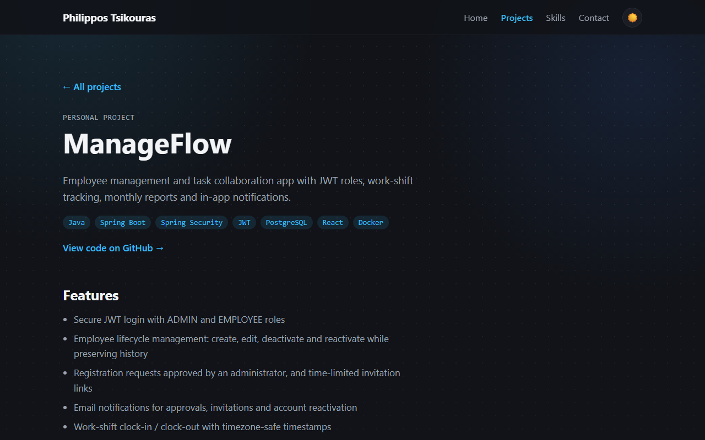
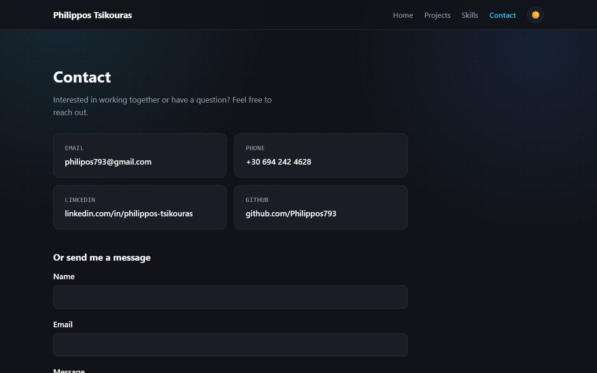

# Philippos Tsikouras — Portfolio

Personal portfolio website showcasing my projects, skills, experience and education as a full-stack developer.

Built as a single-page application with **React** and **Vite**, with client-side routing and component-scoped styling.


## Features

- **Multi-page SPA** with React Router: Home, Projects, a page per project, Skills, Contact and a 404 page
- **Project pages** with features, tech stack and a screenshot gallery that opens in a keyboard-friendly lightbox
- **Lazy-loaded routes** with `React.lazy` and `Suspense`, so each page is downloaded only when it is visited
- **Dark / light theme** with a toggle, shared through React Context and saved in `localStorage` (dark by default, no flash on load)
- **Contact form** built with `useReducer`, client-side validation and submission through Formspree
- **Experience & Education tabs** following the WAI-ARIA tabs pattern, including arrow-key navigation
- **Downloadable CV** and link-preview meta tags (Open Graph)
- **Data-driven content** — projects, skills, experience, education and contact details live in `src/data`, so the UI updates without touching components
- **Reusable components and custom hooks** such as `Section`, `ProjectCard`, `useTheme` and `useDocumentTitle`
- **Responsive layout** with CSS Grid, `clamp()` typography and mobile breakpoints
- **Accessible markup** — semantic HTML, visible focus styles, ARIA where needed and support for reduced motion

## Tech Stack

| Area      | Technology                        |
| --------- | --------------------------------- |
| UI        | React 19                          |
| Build     | Vite                              |
| Routing   | React Router                      |
| Styling   | CSS Modules, CSS custom properties |
| Icons     | Simple Icons                      |
| Forms     | Formspree                         |
| Linting   | Oxlint                            |

## Screenshots

### Projects


### Project page


### Skills


### Contact


## Project Structure

```
src/
  components/   Reusable UI components (Navbar, Hero, Section, ProjectCard, Lightbox, ...)
  pages/        Route-level pages (Home, ProjectDetail, Contact, NotFound)
  context/      Theme context and provider
  hooks/        Custom hooks (useTheme, useDocumentTitle)
  data/         Content: projects, skills, experience, education, contact details
  assets/       Project screenshots
  index.css     Global styles and design tokens
```

## Getting Started

**Prerequisites:** Node.js 20.19+ or 22.12+

```bash
# install dependencies
npm install

# start the development server
npm run dev

# lint the code
npm run lint

# create a production build in dist/
npm run build

# preview the production build locally
npm run preview
```

## Contact

- **Email:** [philipos793@gmail.com](mailto:philipos793@gmail.com)
- **LinkedIn:** [linkedin.com/in/philippos-tsikouras](https://www.linkedin.com/in/philippos-tsikouras)
- **GitHub:** [github.com/Philippos793](https://github.com/Philippos793)
